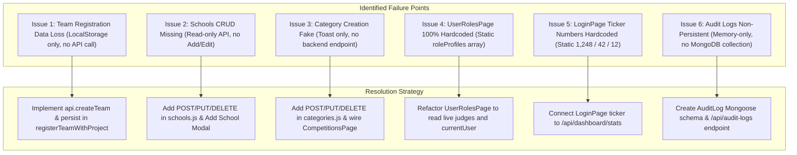

# Techno Talent Feast 2026 — Issues Analysis & Step-by-Step Implementation Plan

---

## 1. Executive Summary of Detected Issues

Following the end-to-end execution of [FULL_APPLICATION_FLOW_TEST_PLAN.md](file:///e:/Techno%20School/Techno-Talent-Feast/FULL_APPLICATION_FLOW_TEST_PLAN.md), the system core is functional (20/20 API tests passed, 0 TypeScript build errors). However, **6 critical architectural issues and static data disconnections** were identified across the frontend and backend:



---

## 2. Detailed Issue Analysis

### Issue 1: Team Registration Disconnect & Data Loss (CRITICAL)
- **Problem**: When an Administrator registers a new team via the modal in [ParticipantsPage.tsx](file:///e:/Techno%20School/Techno-Talent-Feast/src/pages/ParticipantsPage.tsx), `registerTeamWithProject` in [AppContext.tsx](file:///e:/Techno%20School/Techno-Talent-Feast/src/context/AppContext.tsx#L1186-L1230) creates a team object and saves it only to `localStorage` and React state.
- **Root Cause**: It never calls `POST /api/teams`, even though `server/routes/teams.js` has a working `POST /api/teams` route.
- **Symptom**: Every 20 seconds, the automatic background sync (`refreshData()`) fetches live teams from MongoDB Atlas and **overwrites** the React state, silently wiping out the newly created team.
- **Severity**: **HIGH (Data Loss)**.

---

### Issue 2: Missing Backend CRUD for Schools (MEDIUM-HIGH)
- **Problem**: [server/routes/schools.js](file:///e:/Techno%20School/Techno-Talent-Feast/server/routes/schools.js) only implements `GET /` and `GET /:id`.
- **Root Cause**: There are no `POST /`, `PUT /:id`, or `DELETE /:id` handlers for schools in the backend, and [api.ts](file:///e:/Techno%20School/Techno-Talent-Feast/src/services/api.ts) has no corresponding methods.
- **Symptom**: Administrators cannot register a new school, update principal/coordinator contact details, or manage category quota status.
- **Severity**: **MEDIUM-HIGH**.

---

### Issue 3: Disconnected "Create Category" Button (MEDIUM)
- **Problem**: In [CompetitionsPage.tsx](file:///e:/Techno%20School/Techno-Talent-Feast/src/pages/CompetitionsPage.tsx#L47-L56), submitting the "Create Category" modal only executes `addToast(...)` with a dummy message.
- **Root Cause**: [server/routes/categories.js](file:///e:/Techno%20School/Techno-Talent-Feast/server/routes/categories.js) has no `POST` route to receive new categories, and `AppContext.tsx` lacks a `createCategory` function.
- **Symptom**: The UI indicates success, but no category is created or saved in MongoDB Atlas.
- **Severity**: **MEDIUM**.

---

### Issue 4: 100% Static User Roles Directory (LOW-MEDIUM)
- **Problem**: [UserRolesPage.tsx](file:///e:/Techno%20School/Techno-Talent-Feast/src/pages/UserRolesPage.tsx#L56-L100) contains a hardcoded array of `roleProfiles` with mock users (`James Techno`, `Dr. Priya Sharma`, `Eng. Tariq Al Mansoori`).
- **Root Cause**: The page was built with static mock data rather than pulling from `judges` and `currentUser` in `AppContext`.
- **Symptom**: Changes to judges in the Judge Roster or database do not appear in User Roles.
- **Severity**: **LOW-MEDIUM**.

---

### Issue 5: Hardcoded Stat Ticker on Login Screen (LOW)
- **Problem**: [LoginPage.tsx](file:///e:/Techno%20School/Techno-Talent-Feast/src/pages/LoginPage.tsx#L104-L114) hardcodes `"1,248 Participants"`, `"42 Schools"`, and `"12 Competitions"`.
- **Root Cause**: Static JSX markup instead of consuming live counts from `/api/dashboard/stats`.
- **Symptom**: Discrepancy between the numbers shown before and after logging in.
- **Severity**: **LOW (Cosmetic)**.

---

### Issue 6: Memory-Only Audit Trail (LOW-MEDIUM)
- **Problem**: [mockData.ts](file:///e:/Techno%20School/Techno-Talent-Feast/src/data/mockData.ts#L1606) defines `MOCK_AUDIT_LOGS`. Scoring evaluations append an audit item to React state, but it is not stored in MongoDB Atlas.
- **Root Cause**: No `AuditLog` Mongoose model or `/api/audit-logs` endpoint exists.
- **Symptom**: Audit trail clears on page reload.
- **Severity**: **LOW-MEDIUM**.

---

## 3. Step-by-Step Implementation & Fix Plan

### Step 1: Fix Team Registration Persistence (Issue 1)

1. **Update [src/services/api.ts](file:///e:/Techno%20School/Techno-Talent-Feast/src/services/api.ts)**:
   Add client methods for team management:
   ```typescript
   async createTeam(payload: any) {
     return this.request<{ success: boolean; team: any }>('/teams', {
       method: 'POST',
       body: JSON.stringify(payload)
     });
   }

   async updateTeam(id: string, payload: any) {
     return this.request<{ success: boolean; team: any }>(`/teams/${encodeURIComponent(id)}`, {
       method: 'PUT',
       body: JSON.stringify(payload)
     });
   }

   async deleteTeam(id: string) {
     return this.request<{ success: boolean; message: string }>(`/teams/${encodeURIComponent(id)}`, {
       method: 'DELETE'
     });
   }
   ```

2. **Update `registerTeamWithProject` in [src/context/AppContext.tsx](file:///e:/Techno%20School/Techno-Talent-Feast/src/context/AppContext.tsx#L1186)**:
   Make the function async and dispatch `api.createTeam(newParticipant)`:
   ```typescript
   const registerTeamWithProject = async (params: { ... }) => {
     // 1. Build newParticipant payload
     // 2. Call api.createTeam(newParticipant)
     // 3. Update local state and trigger success toast
     // 4. Trigger silent refreshData({ silent: true })
   }
   ```

3. **Update `updateParticipantProject` in [src/context/AppContext.tsx](file:///e:/Techno%20School/Techno-Talent-Feast/src/context/AppContext.tsx#L1145)**:
   Call `api.updateTeam(...)` so project assignment changes persist to MongoDB.

---

### Step 2: Implement Full Schools CRUD (Issue 2)

1. **Update [server/routes/schools.js](file:///e:/Techno%20School/Techno-Talent-Feast/server/routes/schools.js)**:
   Add `POST /`, `PUT /:id`, and `DELETE /:id` handlers:
   ```javascript
   // POST /api/schools
   router.post('/', async (req, res) => {
     try {
       const newSchool = new School(req.body);
       await newSchool.save();
       res.status(201).json({ success: true, school: newSchool });
     } catch (err) {
       res.status(400).json({ error: err.message });
     }
   });

   // PUT /api/schools/:id
   router.put('/:id', async (req, res) => {
     try {
       const updated = await School.findOneAndUpdate(
         { $or: [{ id: req.params.id }, { _id: req.params.id }] },
         { $set: req.body },
         { new: true }
       );
       res.json({ success: true, school: updated });
     } catch (err) {
       res.status(400).json({ error: err.message });
     }
   });

   // DELETE /api/schools/:id
   router.delete('/:id', async (req, res) => {
     try {
       await School.findOneAndDelete({ $or: [{ id: req.params.id }, { _id: req.params.id }] });
       res.json({ success: true, message: 'School removed.' });
     } catch (err) {
       res.status(400).json({ error: err.message });
     }
   });
   ```

2. **Add API Methods in [src/services/api.ts](file:///e:/Techno%20School/Techno-Talent-Feast/src/services/api.ts)**:
   `createSchool`, `updateSchool`, `deleteSchool`.

3. **Add Context Actions in [src/context/AppContext.tsx](file:///e:/Techno%20School/Techno-Talent-Feast/src/context/AppContext.tsx)**:
   `createSchool`, `updateSchool`, `deleteSchool`.

4. **Add "Create / Edit School" Modal in [src/pages/SchoolsPage.tsx](file:///e:/Techno%20School/Techno-Talent-Feast/src/pages/SchoolsPage.tsx)**:
   Allows adding a school with Name, City, Principal, Coordinator, and initial category quotas.

---

### Step 3: Implement Full Category CRUD (Issue 3)

1. **Update [server/routes/categories.js](file:///e:/Techno%20School/Techno-Talent-Feast/server/routes/categories.js)**:
   Add `POST /`, `PUT /:id`, and `DELETE /:id` endpoints.
2. **Add API Methods in [src/services/api.ts](file:///e:/Techno%20School/Techno-Talent-Feast/src/services/api.ts)**:
   `createCategory`, `updateCategory`, `deleteCategory`.
3. **Wire [CompetitionsPage.tsx](file:///e:/Techno%20School/Techno-Talent-Feast/src/pages/CompetitionsPage.tsx#L47)**:
   Connect `handleCreateComp` to `api.createCategory(...)` so new arenas save directly into MongoDB Atlas.

---

### Step 4: Make UserRolesPage Dynamic (Issue 4)

1. **Update [src/pages/UserRolesPage.tsx](file:///e:/Techno%20School/Techno-Talent-Feast/src/pages/UserRolesPage.tsx)**:
   Replace the static `roleProfiles` array with a dynamic computation:
   - Include the active Administrator (`currentUser`).
   - Map over the live `judges` array from `AppContext`.
   - Compute real live statistics (`completedCount`, `quotaCount`, assigned categories, assigned halls).

---

### Step 5: Connect Login Screen Ticker to Live API (Issue 5)

1. **Update [src/pages/LoginPage.tsx](file:///e:/Techno%20School/Techno-Talent-Feast/src/pages/LoginPage.tsx#L104-L114)**:
   Add a quick `useEffect` on mount to call `fetch('/api/dashboard/stats')` and update:
   - Participants: Live `totalTeams` count.
   - Schools: Live `totalSchools` count.
   - Competitions: Live `totalCategories` count.

---

### Step 6: Persistent Audit Logs (Issue 6)

1. Create `server/models/AuditLog.js` with fields: `id`, `userName`, `userRole`, `action`, `details`, `timestamp`, `ipAddress`.
2. Add `server/routes/auditLogs.js` with `GET /` and `POST /`.
3. Register `/api/audit-logs` in `server/server.js` and `api/index.js`.
4. Connect `addAuditLog` in `AppContext.tsx` to `POST /api/audit-logs`.

---

## 4. Implementation Priority Matrix

| Priority | Task | Affected Files | Effort | Impact |
| :---: | :--- | :--- | :---: | :---: |
| **P0** | **Fix Team Registration Persistence** | `api.ts`, `AppContext.tsx`, `ParticipantsPage.tsx` | 30 mins | **Prevents data loss on team enrollments** |
| **P1** | **Schools CRUD Endpoints & UI** | `server/routes/schools.js`, `api.ts`, `SchoolsPage.tsx` | 35 mins | **Enables managing participating institutions** |
| **P1** | **Category CRUD Endpoints & UI** | `server/routes/categories.js`, `api.ts`, `CompetitionsPage.tsx` | 25 mins | **Persists newly created categories to Atlas** |
| **P2** | **Dynamic UserRolesPage** | `UserRolesPage.tsx` | 20 mins | **Eliminates static mock juror profiles** |
| **P2** | **Dynamic Login Ticker** | `LoginPage.tsx` | 15 mins | **Reflects live database stats on login screen** |
| **P3** | **Persistent Audit Trail** | `AuditLog.js`, `auditLogs.js`, `AppContext.tsx` | 25 mins | **Maintains permanent competition audit trail** |
